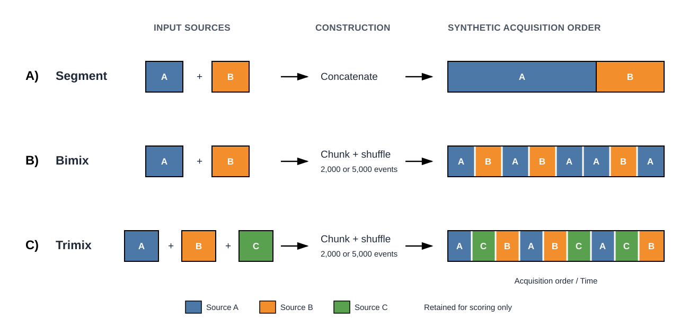
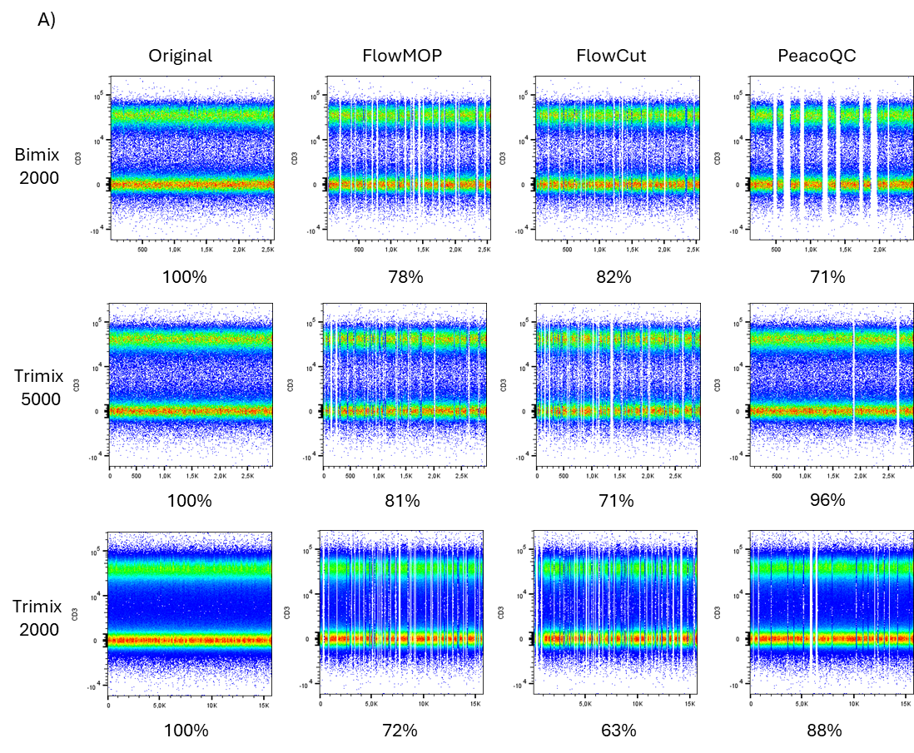
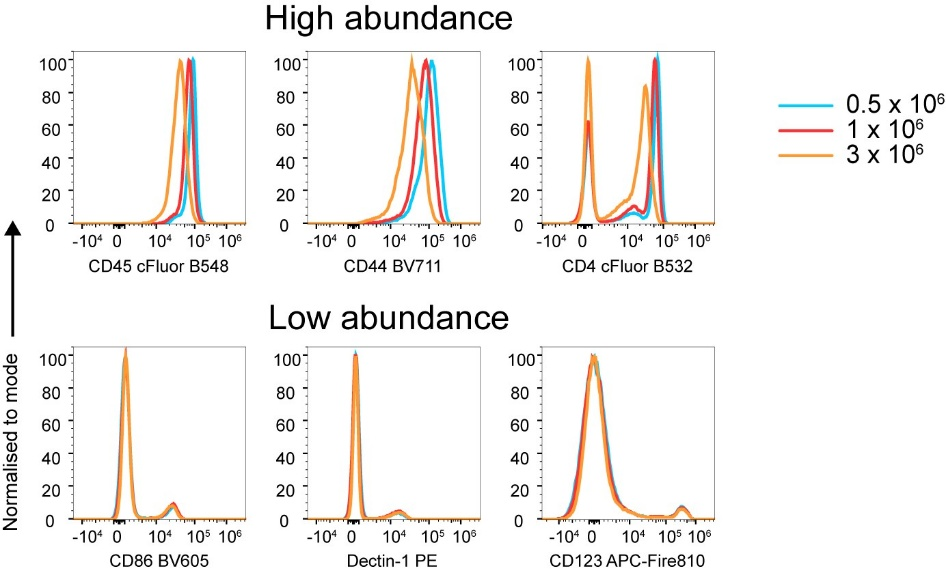
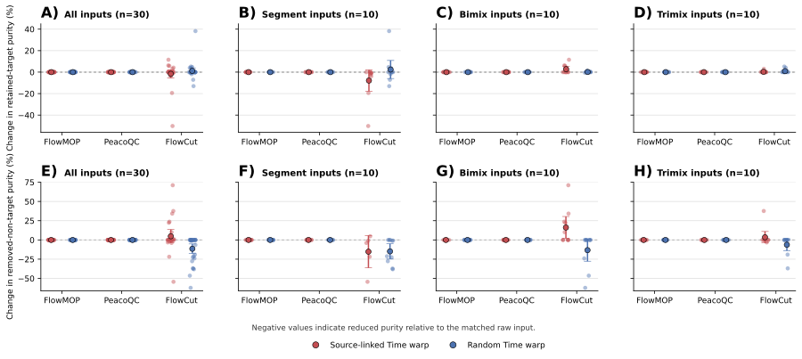
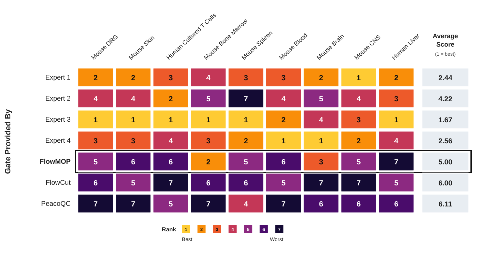
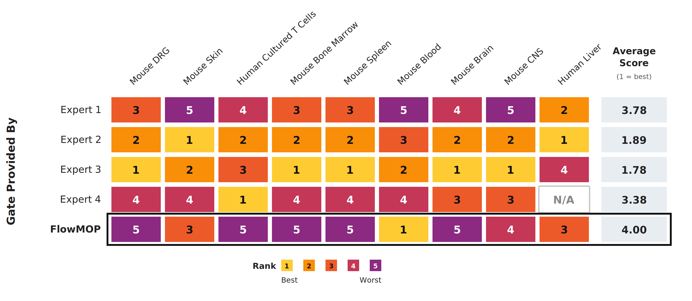
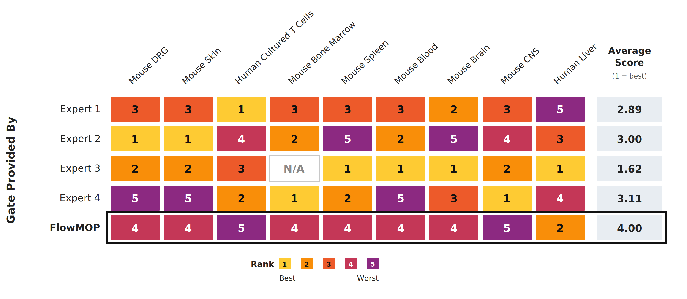

## Supplementary data

Figure S1: Construction of Segment, Bimix, and Trimix synthetic time samples. No flow-rate disturbance was introduced.

Figure S2: Representative CD3-versus-Time plots for Bimix samples with 2,000-event bins and Trimix samples with 2,000- and 5,000-event bins, showing the original inputs and outputs after cleaning with FlowMOP, FlowCut, and PeacoQC. Percentages below each figure represent the retained proportion of cells relative to the original representative synthetic sample.

**Table S1: Dataset Compositions**

| Dataset Name | Synthetic Time-Gating Dataset | Synthetic Debris-Gating Dataset | Synthetic Doublet-Gating Dataset | Human Liver |
| --- | --- | --- | --- | --- |
| Samples (given per benchmarker) | 6, 2 each at 0.5, 1, 3 cell concentrations, 3 datasets | 4, combined into 3 benchmarking samples | 4, combined into 3 benchmarking samples | 3 |
| Tissue Type | Peripheral blood mononuclear cells | Spleen | Spleen | Liver tissue |
| Organism | Human | Mouse | Mouse | Human |
| Collection Location | Canberra, ACT, Australia | Canberra, ACT, Australia | Canberra, ACT, Australia | Sydney, NSW, Australia |

| Mouse Dorsal Root Ganglion | Mouse Skin | Mouse Small Intestine | Mouse Colon | Mouse Brain |
| --- | --- | --- | --- | --- |
| 3 | 3 | 3 | 3 | 4 |
| Dorsal root ganglia | Skin | Distal small intestine | Colon | Brain |
| Mouse | Mouse | Mouse | Mouse | Mouse |
| Canberra, ACT, Australia | Canberra, ACT, Australia | Canberra, ACT, Australia | Canberra, ACT, Australia | Canberra, ACT, Australia |

| Mouse Central Nervous System | Mouse Spleen | Mouse Blood | Mouse Bone Marrow | Human Cultured T cells |
| --- | --- | --- | --- | --- |
| 3 | 7 | 5 | 3 | 5 |
| Spinal cord and brain | Spleen | Peripherally collected blood | Femur derived bone marrow | Peripherally collected, cultured, and restimulated T cells |
| Mouse | Mouse | Mouse | Mouse | Human |
| Canberra, ACT, Australia | Canberra, ACT, Australia | Canberra, ACT, Australia | Canberra, ACT, Australia | Canberra, ACT, Australia |

**Table S2: Jeffreys’ Scale**

| Bayes Factor | Hypothesis descriptor |
| --- | --- |
| <1 | Null hypothesis supported |
| 1-3 | Anecdotal / Weak evidence |
| 3-10 | Moderate / Substantial evidence |
| 10-30 | Very strong evidence |
| >30 | Decisive evidence |

**Table S3: Limit-of-detection precleaning in biological-validation inputs**

Events with passed_lod values below 0.5 were counted as removed. FlowMOP removes maximum-FSC-A events only when they exceed 1% of the input. This 1% cutoff is an arbitrary operational safeguard, not an empirically optimized biological threshold. Activation depends on acquisition scaling and voltage/gain settings; the observed activation rates are dataset-specific and should not be generalized across instruments.

| Dataset | Sample | Input events | Events removed | Events removed (%) | Threshold activated |
| --- | ---: | ---: | ---: | ---: | --- |
| PBMC | 1 | 143,656 | 0 | 0.00 | No |
| PBMC | 2 | 426,248 | 0 | 0.00 | No |
| PBMC | 3 | 463,512 | 0 | 0.00 | No |
| PBMC | 4 | 258,952 | 0 | 0.00 | No |
| PBMC | 5 | 140,936 | 0 | 0.00 | No |
| PBMC | 6 | 161,704 | 0 | 0.00 | No |
| PBMC | 7 | 242,344 | 0 | 0.00 | No |
| PBMC | 8 | 188,936 | 0 | 0.00 | No |
| Tumour | 1 | 287,752 | 6,863 | 2.39 | Yes |
| Tumour | 2 | 145,520 | 3,472 | 2.39 | Yes |
| Tumour | 3 | 301,872 | 9,206 | 3.05 | Yes |

**Table S4: Full-dataset FlowMOP MAD-smoothing analysis**

| Short, long smoothing factors | Sensitivity | Specificity | Balanced mean |
| --- | ---: | ---: | ---: |
| 0,0 (no-smoothing control) | 0.8021 | **0.7081** | **0.75506** |
| **0.01,0.05 (current default)** | 0.8212 | 0.6811 | **0.75114** |
| 0.02,0.05 | 0.8228 | 0.6794 | 0.75108 |
| 0.01,0.02 | 0.8112 | 0.6885 | 0.74986 |
| 0.02,0.09 | **0.8276** | 0.6709 | 0.74923 |
| 0.01,0.09 | 0.8257 | 0.6707 | 0.74823 |
| 0.05,0.09 | 0.8188 | 0.6676 | 0.74317 |
| 0.02,0.20 | 0.8248 | 0.6479 | 0.73632 |
| 0.05,0.20 | 0.8197 | 0.6520 | 0.73586 |
| 0.01,0.20 | 0.8231 | 0.6477 | 0.73540 |
| 0.10,0.20 | 0.8138 | 0.6415 | 0.72769 |
| 0.05,0.34 | 0.8194 | 0.6344 | 0.72686 |
| 0.02,0.34 | 0.8199 | 0.6286 | 0.72424 |
| 0.10,0.34 | 0.8134 | 0.6250 | 0.71921 |
| 0.10,0.50 | 0.8139 | 0.6229 | 0.71842 |
| 0.10,0.90 (former default) | 0.8139 | 0.6226 | 0.71827 |
| 0.10,1.00 | 0.8139 | 0.6226 | 0.71827 |
| 0.20,0.90 | 0.8007 | 0.6142 | 0.70747 |
| 0.40,0.90 | 0.7812 | 0.6140 | 0.69756 |

Values are equally weighted macro-averages across the six Figure 2 benchmark groups (173 primary inputs; six tied-composition inputs excluded). The balanced mean is the arithmetic mean of sensitivity and specificity. Bold indicates the highest value overall and the highest balanced mean among smoothed settings.

Figure S3: Fluorescence variation as a function of cell concentration.

Figure S4: Time-only acquisition-rate perturbations reveal FlowCut sensitivity to local Time density. Points show raw-matched changes in sensitivity (A-D) and specificity (E-H), with large points and intervals showing the mean and 95% confidence interval. Negative values indicate reduced performance relative to the raw control. Columns show all inputs together and the Segment, Bimix, and Trimix subsets separately. FlowMOP and PeacoQC remain unchanged under both source-linked and random Time warping. In contrast, FlowCut's sensitivity and specificity shift after Time-only perturbation, with the clearest specificity loss in random Time-warped inputs and the strongest source-linked sensitivity loss in Segment inputs, where acquisition-rate structure aligns with source composition.

### Supplementary expert preference evaluation

#### Supplementary methods

The expert-ranking analysis was used to summarize relative preferences among gates generated by FlowMOP, comparator algorithms, and human operators; it was not treated as an absolute measure of gating adequacy [S1].

Rankings were modelled using a Plackett–Luce model with latent method abilities; identifiability was enforced by fixing a reference ability to zero. Independent Normal priors were placed on non-reference abilities. Posterior inference was performed with an affine-invariant ensemble Markov Chain Monte Carlo sampler (emcee; 32 walkers, 5,000 iterations; 1,000 burn-in), and posterior medians with 95% credible intervals were reported. Directional hypotheses (superiority/inferiority) were evaluated by computing P = Pr(H1 | data) and converting to a Bayes factor BF₁₀ = p/(1 – p) under equal prior odds, interpreted using Jeffreys’ scale and reported as BF, P (Bayes factor, posterior probability of the alternative hypothesis) (Table S2).

For each Plackett–Luce fit, the ensemble sampler’s mean acceptance fraction and an integrated-autocorrelation-time-based effective sample size were monitored (both as implemented in emcee) to assess MCMC convergence. Across all analyses, mean acceptance fractions ranged from 0.520 to 0.60, and effective sample sizes ranged from 128,003 to 134,042.

Posterior predictive checks compared observed pairwise win counts with those implied by posterior draws under a Bradley–Terry formulation, using a chi-square-type discrepancy averaged over method pairs. The maximum average χ² per comparison was 0.56, indicating good agreement between the model and the observed rankings.

Computations were implemented in Python with numerically stable log-likelihoods.

#### Supplementary results

FlowMOP outputs were compared with expert-provided gates using a forced-ranking preference task across nine biological datasets. These rankings measure relative expert preference and should not be interpreted as an absolute measure of gating adequacy. The resulting time, debris, and doublet gates were ranked by an expert familiar with that sample type. FlowCut and PeacoQC were also included in the time-gating comparison. Rank 1 indicates greatest preference.

Figure S5. Expert preference rankings for time gates provided by four human experts, FlowMOP (black border), FlowCut, and PeacoQC across nine datasets. Rows indicate the gate provider, and the final column shows the mean rank across datasets. Rank 1 indicates greatest preference; therefore, a lower average score indicates greater preference. Abbreviations: DRG, dorsal root ganglion; CNS, central nervous system.

In the biological datasets, FlowMOP had the lowest mean rank among the algorithmic time-gating approaches (Fig. S5). In the mouse brain and mouse bone marrow tasks, it ranked third and second, respectively (Fig. S5). On a Bayesian analysis, FlowMOP was observed to be substantially preferred to FlowCut (BF = 5.39, P = 84.3%) and strongly preferred to PeacoQC (BF = 12.10, P = 92.4%). FlowMOP was ranked inferiorly to all human experts with strong to decisive evidence (Expert 2 BF = 10.55, P = 91.3%, all others BF > 100, P = 100%).

Figure S6. Expert preference rankings for debris gates provided by four human experts and FlowMOP (black border) across nine datasets. Rows indicate the gate provider, and the final column shows the mean rank across available datasets. Rank 1 indicates greatest preference; therefore, a lower average score indicates greater preference. N/A denotes an unavailable gate.

Figure S7. Expert preference rankings for doublet gates provided by four human experts and FlowMOP (black border) across nine datasets. Rows indicate the gate provider, and the final column shows the mean rank across available datasets. Rank 1 indicates greatest preference; therefore, a lower average score indicates greater preference. N/A denotes an unavailable gate.

FlowMOP had the highest mean rank when compared with the human experts for debris and doublet removal (Figs. S6, S7). On a Bayesian analysis, substantial to strong evidence was observed for FlowMOP being inferior to Expert 1 (BF = 5.87, P = 85.5%), Expert 4 (BF = 12.85, P = 92.8%), and Experts 2 and 3 (BF > 100, P = 100%) in debris removal. In doublet removal, FlowMOP was weakly inferiorly ranked to Expert 4 (BF = 3.14, P = 75.8%), substantially inferiorly ranked to Expert 1 (BF = 5.67, P = 85.0%), strongly inferiorly ranked to Expert 2 (BF = 14.38, P = 93.5%), and decisively inferiorly ranked to Expert 3 (BF > 100, P = 100%).

FlowMOP’s relative expert preference varied across datasets. For debris, it ranked first in the mouse blood task and third in the human liver and mouse skin datasets. In the doublet task, FlowMOP ranked second in the human liver task. Complete dataset-level rankings and mean ranks are shown in Figures S5-S7.

Figure S8. Representative debris and doublet preprocessing projections. A) Debris comparison for Ungated input, Expert Manual, and FlowMOP. B) Doublet comparison for Ungated input, Expert Manual, and FlowMOP. Each row also shows the standalone Live CD45+ reference and the corresponding B/T and NKT gates evaluated without a CD45+ parent. The corresponding module-specific statistics are reported in Figure 6B,C.

## References

[S1]	Noah Castelo, Maarten W. Bos, and Donald R. Lehmann. 2019. Task-Dependent Algorithm Aversion. Journal of Marketing Research 56, 5 (October 2019), 809–825. https://doi.org/10.1177/0022243719851788
